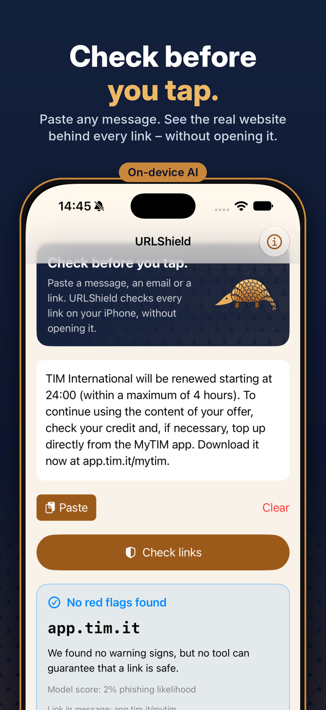
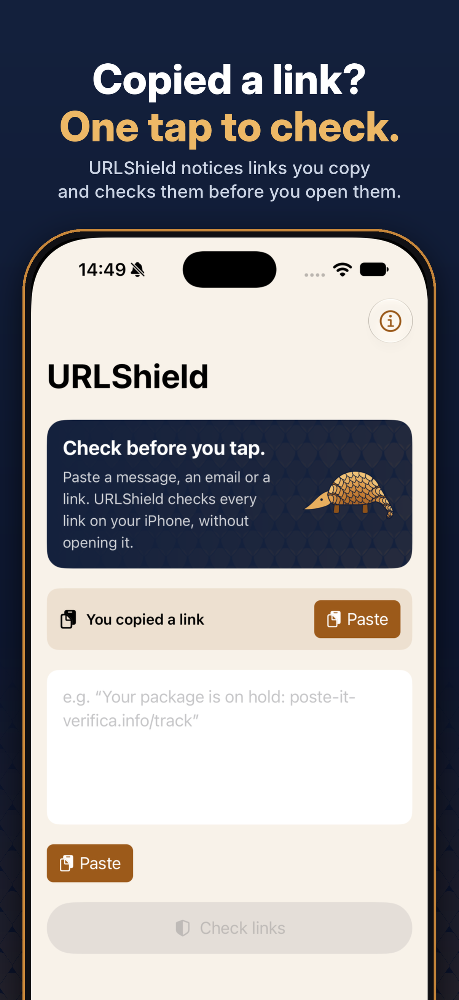
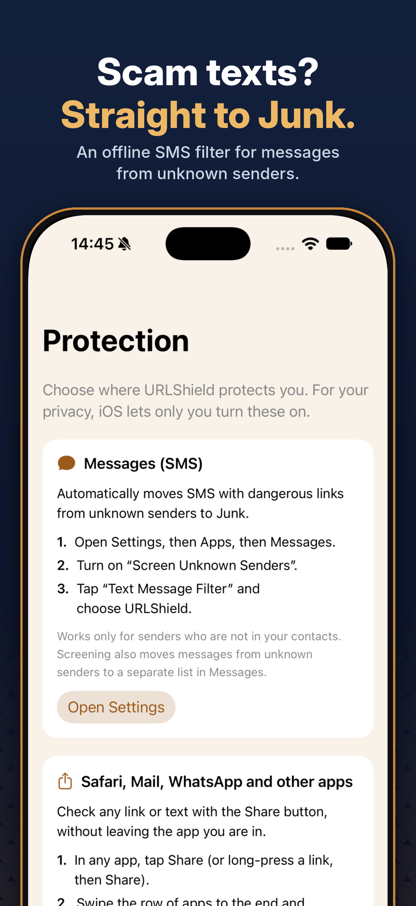
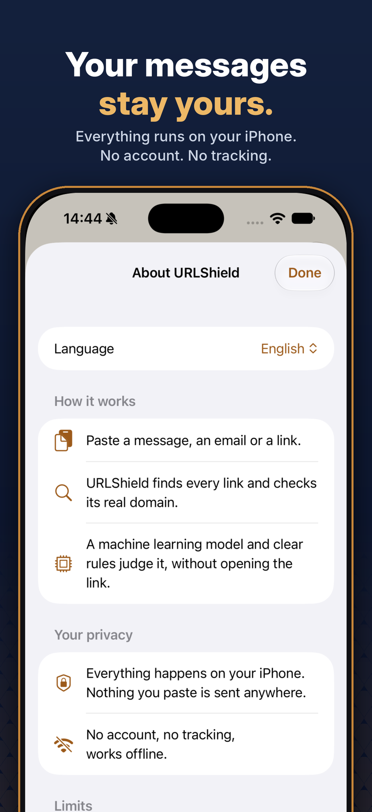

<p align="center"></p>

<h1 align="center">URLShield</h1>
<p align="center"><b>Check before you tap.</b><br>
An iOS app that spots phishing links in SMS, emails and messages – fully on-device, without ever opening the link.</p>

<p align="center">
   
</p>

---

## What it does

- **Check any text** – paste a message; URLShield finds every link (even bare domains like `xk7q9z2p.top`), shows the *real* domain and gives an explained verdict: *Likely phishing · Suspicious · Known site · Hidden destination (shortener) · Open platform · No red flags*.
- **SMS filter** – an offline `ILMessageFilterExtension` moves messages from unknown senders with a likely-phishing link to Junk.
- **Share extension** – check text or links from Messages, Mail, Safari and other apps.
- **Spot the fake** – a small game that teaches the tricks scammers use.
- **English & Italian**, in-app language picker.
- **Privacy:** no account, no analytics, no data collected. The only network request downloads a **signed** model update.

## The machine-learning part

This project started as an ML learning project. The most important lesson came first:

### 1. The 99% model that learned a shortcut
The first model, trained on full URLs from the [PhiUSIIL dataset](https://archive.ics.uci.edu/dataset/967/phiusiil+phishing+url+dataset), scored ~99%. Real testing showed it had learned a shortcut: **every legitimate URL in the dataset had the form `https://www.<domain>`**, so a one-line rule scored almost as well and the model flagged any link typed without `www.`.

### 2. Hostname-only model
The fix was to remove the shortcut by design: normalize every URL to its **hostname** (drop scheme, `www.`, path, port, user-info), de-duplicate, remove URL shorteners / open platforms / IPFS gateways (handled by rules instead), and evaluate with a **split by registrable domain** (0 overlap between train and test).

Features (identical in Python and Swift, verified by 317 parity tests):
`host_length, dot_count, hyphen_count, digit_count, digit_ratio, longest_label_length, char_entropy, has_ip_address, suspicious_keyword_count, tld_phish_rate` (smoothed target encoding of the TLD).

Model: Random Forest (scikit-learn) → Core ML.

### 3. Honest results

| Test | ROC AUC | Caught at P ≥ 0.9 | False alarms at P ≥ 0.9 |
|---|---|---|---|
| v1 – unseen PhiUSIIL domains | 0.888 | 57.4% | 0.3% |
| v1 – fresh phishing + less popular real sites | 0.858 | 62.1% | **3.9%** |
| **v2** – same fresh data (domains never trained on) | **0.913** | 62.1% | **0.09%** |

v2 adds ~290k fresh phishing hosts ([Phishing.Database](https://github.com/mitchellkrogza/Phishing.Database), MIT) and ~290k legitimate domains ([Tranco list](https://tranco-list.eu)). The fresh-data test showed that v1's "0.3% false alarms" only held for famous sites – a finding that only appeared with out-of-distribution evaluation.

### 4. The model is one signal, not the judge
`LinkAnalyzer` combines: shortener & open-platform lists → allowlist (Tranco top sites minus hosting platforms) → red-flag rules (IP address, `@` trick, punycode, brand inside a fake domain, typosquatting such as `paypa1.com`, `rnicrosoft.com`, `appl22.com`) → Core ML probability. The app never says "safe".

### 5. Signed over-the-air model updates
New models ship without an App Store update: `publish_update.py` writes a manifest with SHA-256 hashes and an **Ed25519 signature**; the app verifies the signature, the hashes and a set of self-test predictions, compiles the model on device and swaps it atomically. Updates are shared with the extensions through an App Group.

## Repository structure

```
app/        Xcode project (SwiftUI app, Share extension, SMS filter extension, tests)
ml/         Python pipeline: dataset building, features, training, evaluation, Core ML export, update publishing
website/    Privacy policy and support pages
docs/       App Store listing and screenshots
brand/      App icon
```

## Reproduce the model

Requires Python 3.9 with `scikit-learn==1.5.1` and `coremltools==9.0` (see `ml/requirements.txt`).
Datasets are **not** included – download them into `ml/`:
- `PhiUSIIL_Phishing_URL_Dataset.csv` – UCI Machine Learning Repository (CC BY 4.0)
- `tranco.csv` – [tranco-list.eu](https://tranco-list.eu)

```bash
cd ml
python build_host_dataset.py && python clean_hosts.py && python build_features.py
python train_evaluate.py          # domain-split evaluation
python train_final.py             # v1 model + Core ML
python fetch_fresh_phishing.py    # fresh phishing data
python temporal_eval.py           # v1 on unseen data
python train_v2.py                # v2 model + fair v1/v2 comparison
python make_allowlist.py
```

To publish your own updates, run `make_signing_key.py` (keep the private key **out of git**) and put your public key in `ModelUpdater.swift`.

## Limitations
- Judges the hostname only; a hacked legitimate site will look normal.
- Brand-imitation rules cover a fixed list of brands.
- Unknown legitimate subdomains score higher than bare domains.

## Credits
PhiUSIIL dataset (UCI, CC BY 4.0) · Phishing.Database by Mitchell Krog (MIT) · Tranco list.
Built by **Navid Zare** at the Apple Developer Academy, Naples.
